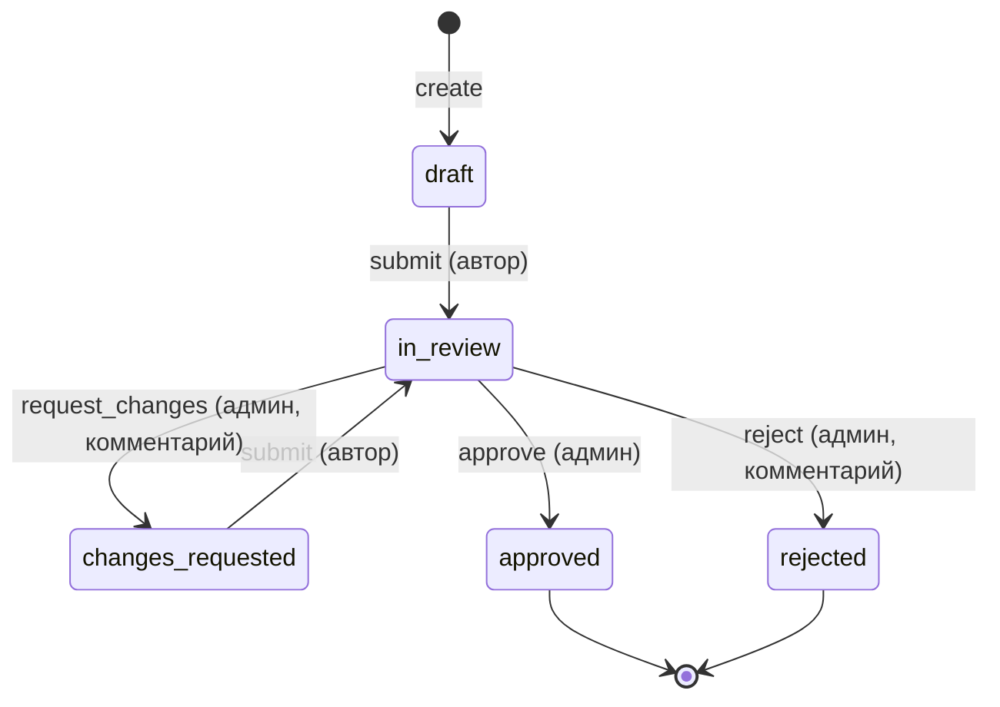

# Архитектурный документ

> Шаблон. В день хакатона заполнить под свой кейс. Структура — по этапам проектирования:
> 1) требования, 2) сценарии, 3) данные, 4) API, 5) архитектура и решения.
> (Список «5 обязательных этапов» из критериев жюри уточнить в Положении о хакатоне и при необходимости переименовать разделы.)
> Главное правило жюри: **документ должен соответствовать реально написанной системе**, а решения — быть обоснованы.

## 1. Требования

| Роль | Что нужно |
|---|---|
| Автор (user) | создавать записи, править черновики, отправлять на согласование, видеть историю |
| Согласующий (admin) | видеть все записи, согласовать / отклонить / вернуть на доработку с комментарием |

Нефункциональные: авторизация по JWT; чужие записи недоступны; все изменения статусов фиксируются; сервис доступен по URL, документация API — `/api/docs`.
**Вне объёма** (осознанно): уведомления, файлы, многоуровневое согласование.

## 2. Сценарии и процесс



Правила описаны данными в `backend/app/services/items.py` (`RULES`): откуда → куда, кто может, нужен ли комментарий.
Невозможный переход → `409`, нет прав → `403`, нет обязательного комментария → `422`.

## 3. Данные

```mermaid
erDiagram
    USERS ||--o{ ITEMS : "owner_id"
    USERS ||--o{ ITEM_EVENTS : "actor_id"
    ITEMS ||--o{ ITEM_EVENTS : "item_id"
    USERS { int id PK; string email UK; string full_name; string password_hash; string role }
    ITEMS { int id PK; string title; text description; int amount; string status; int owner_id FK }
    ITEM_EVENTS { int id PK; int item_id FK; int actor_id FK; string action; string from_status; string to_status; string comment }
```

Индексы: `users.email` (уникальный, вход), `items.status` (фильтр), `(items.owner_id, items.status)` («мои записи» с фильтром), `item_events.item_id` (история записи).
Миграции: `backend/alembic/versions/`, применяются при старте; CI проверяет `upgrade → downgrade → upgrade` на PostgreSQL.

## 4. API

Полная спецификация — Swagger `/api/docs`, OpenAPI `/api/openapi.json`.

| Метод | Путь | Назначение |
|---|---|---|
| POST | `/api/auth/register`, `/api/auth/login` | регистрация, вход → JWT |
| GET | `/api/auth/me` | текущий пользователь |
| GET | `/api/items?status&q&limit&offset` | список: фильтр, поиск, пагинация |
| POST | `/api/items` | создать (черновик) |
| GET / PATCH | `/api/items/{id}` | получить / изменить (автор, черновик или доработка) |
| POST | `/api/items/{id}/transitions` | сменить статус (`action` + `comment`) |
| GET | `/api/items/{id}/events` | история |
| GET | `/api/health` | проверка живости (+ запрос к БД) |

Единый формат ошибки: `{"detail", "code", "request_id", "errors?"}`.

## 5. Архитектура и решения

```
Браузер ──► nginx (статика React, /api → backend) ──► FastAPI ──► PostgreSQL
                                                     router → service → repository
```

| Решение | Почему |
|---|---|
| Слои router / service / repository | логика не в контроллерах; сервисы тестируются без HTTP; легко менять правила |
| Правила переходов — таблица `RULES` | новый статус = одна строка + тест, нет «магических» if-ов |
| Статус и запись в историю в одной транзакции | история никогда не расходится с состоянием |
| Чужая запись → `404`, а не `403` | не раскрываем существование данных |
| JWT (HS256), пароли — scrypt с солью | без внешних зависимостей, стандартно |
| `joinedload` для владельца | один запрос вместо N+1 при выдаче списка |
| nginx проксирует `/api` | один origin: нет CORS и лишних настроек на проде |
| SQLite локально, PostgreSQL в Docker/CI | быстрый старт; схема проверяется на реальной СУБД в CI |
| JSON-логи в stdout + `request_id` | один поток логов для всех сервисов; по `request_id` из ответа находим запись |

Известные ограничения: токен хранится в `localStorage` (для продакшена — httpOnly-cookie); нет rate limiting; нет refresh-токенов.
