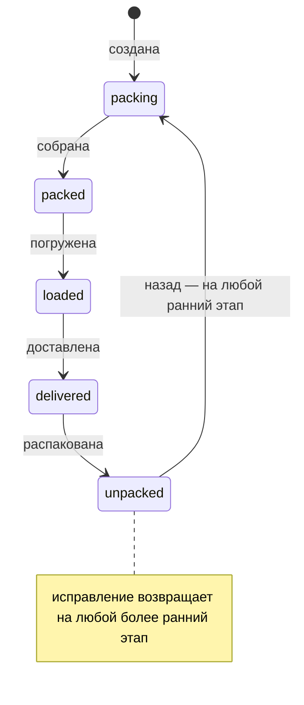
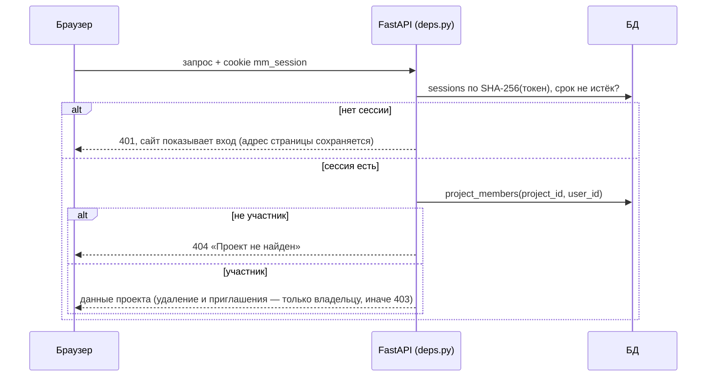

# Архитектурный документ: MoverMate

> Пять этапов проектирования: 1) требования, 2) сценарии и процессы, 3) данные, 4) API, 5) архитектура и обоснование решений.
> **Документ описывает развёрнутую систему** (https://hack-led-20-vm1-12902f.vmaas-spirit.t-education.com, состояние на 18.10.2026, master GitLab): каждое утверждение сверено с кодом. Источник правды по API — Swagger `/api/docs`; контракт с примерами — `docs/API.md`; разбор ТЗ и проверка минимума — `docs/CASE.md`.

## 1. Требования

**Пользователи.** Человек или семья, готовящиеся к переезду (**владелец проекта**), и их помощники — грузчики, родные (**участники**, приходят по ссылке-приглашению). Учётная запись — только логин и пароль, без почты и телефона. «Ответственный» за задачу — просто имя в задаче, не аккаунт.

**Функциональные требования** (нумерация разделов — как в ТЗ и таблице минимума `CASE.md`):

| Группа | Требования | Где реализовано |
|---|---|---|
| План (5.1) | проект с названием, датой и необязательными адресами; при создании — стандартный план (14 задач трёх этапов со сроками от даты переезда) или пустой; персональный ИИ-план с уточняющими вопросами; свои задачи со сроком, временем начала и конца, категорией с цветом, ответственным; отметка выполнения | `services/projects.py`, `services/tasks.py`, `services/planner.py`, экран «План» |
| Коробки (5.2) | уникальный номер и комната; вещи списком (быстрый ввод по строке) или по фото (ИИ); «заполнить позже» с напоминанием; 5 статусов коробки: вперёд по порядку, назад — на любой этап без причины; статус каждой вещи; удаление с подтверждением | `services/boxes.py`, `services/vision.py`, экраны «Коробки» и карточка |
| Поиск и этикетки (5.3) | поиск вещи по названию с коробкой, комнатой и статусом; поиск коробки по номеру; этикетка с крупным номером и QR (обычный адрес или компактный код `MM1:…`); печать A4 шаблонами или PDF; показ на телефоне; QR открывает карточку; поиск понимает формы слова («зарядка» находит «Зарядки»); распознавание рукописного номера — экспериментально, в обычной сборке выключено | `BoxService.search`, `services/qr_codes.py`, экраны «QR-этикетки», сканер |
| Контроль (5.4) | погрузка и доставка по комнатам (массово, чек-лист погрузки комнаты); счётчики по статусам; прогресс по комнатам; первый день: «Что подготовить» и «В коробках» с отметкой «распаковано»; статус вещи (упакована, распакована, найдена, потеряна, повреждена), для потерянной — подсказки, где искать; итог переезда | `progress`, `bulk_transition`, `services/extras.py`, экраны «Прогресс» и «План» |
| Памятки (5.5) | хрупкое, что везти с собой, что паковать последним; хранятся в БД | `reference_data.py`, страница `/tips`, ссылка внизу «Коробок» |
| Доступ | вход по логину и паролю; проект видят только участники; владелец приглашает по ссылке, убирает участников, отзывает ссылки; смена пароля | `services/auth.py`, `deps.py`, личный кабинет `/profile`; гость видит «О нас», «Путь переезда» и «Вопросы» |
| Дополнительно (6) | умный чек-лист на правилах (дети, животные, другой город, аренда, документы, разбор вещей, «обжиться»); ИИ через LLM-прокси Spirit: план с уточняющими вопросами, опись коробки по фото, раскладка комнаты по фото (вторая модель для фото); калькулятор переезда; бюджет «план–факт»; страница «Путь переезда» (7 этапов); подсказки адреса MapTiler или Google по кнопке | `services/assistant.py`, `planner.py`, `vision.py`, `calculator.py`, `budget.py`, `features/journey/` |

**Нефункциональные требования:**

| Группа | Требование | Как выполнено |
|---|---|---|
| Надёжность | номера не повторяются в проекте; повторный скан QR не создаёт дубль; статусы коробки вперёд идут по порядку, назад — на любой этап без причины; одинаковые запросы дают одинаковый ответ; данные переживают обновление страницы | `UNIQUE(project_id, number)`; `GET` карточки только читает; таблица `TRANSITIONS`; детерминированная сортировка; всё хранится на сервере |
| Приватность | персональные данные и адреса необязательны; нет скрытых передач третьим лицам; QR и этикетки генерируются локально | хранится только логин и хэш пароля; QR строится в браузере; ИИ вызывается только по явному согласию (`consent: true`), фото уменьшается в браузере и не хранится, ответ модели — черновик до подтверждения |
| Безопасность | чужой проект недоступен; пароли и токены не хранятся открыто; защита от перебора пароля | проверка участия в каждом запросе; scrypt; SHA-256 токенов; ограничение неудачных входов |
| Производительность | сотни коробок и тысячи вещей; быстрый поиск; пагинация | индексы, `page/page_size`; нагрузочный проект `python -m app.seed --load` (300 коробок, 3000 вещей) |
| Наблюдаемость | журнал важных событий; проверка работоспособности; логи для Sage | таблица `events`, `GET /api/health`; JSON-логи в формате Sage (`@timestamp`, `env`, `system`, `inst`, `level`): каждый запрос (уровень по статусу), каждая ошибка с кодом и причиной (`app_error`, `validation_failed`, `unhandled_exception` со стеком), аудит действий `action=…` (вход и выход, неудачный вход, регистрация, проекты, задачи, коробки, статусы, вещи, приглашения, участники); пароли, токены и названия вещей в логи не пишутся. Аппендер `app/sage_appender.py` шлёт логи в Sage Logs Collector пачками в фоне (`SAGE_LOGS_URL`, `SAGE_API_KEY`). В каждой строке — `trace_id`/`span_id` и текст `message`; трейсинг OpenTelemetry (`app/tracing.py`) отправляется в Sage при заданном `SAGE_TRACES_ENDPOINT`; ответ содержит `x-trace-id` |
| Запуск | без сложных внешних настроек | `scripts/run-site.sh` одной командой; на ВМ один `docker compose up` |

**Вне объёма (осознанно):** роли сложнее «владелец / участник»; восстановление пароля по почте (почту не храним); push, почта и Telegram-уведомления; серверная генерация PDF (печать через браузер); маркетплейс подрядчиков и страхование груза (концепция — `docs/FEATURES.md`, раздел 1).

## 2. Сценарии и процессы

Четыре сценария ТЗ плюс доступ:

1. **Планирование.** Регистрация или вход → калькулятор переезда (бюджет, коробки, машина, сроки) → создание проекта (название, дата; стандартный план из 14 задач со сроками или пустой; по желанию ИИ-план: описание → уточняющие вопросы → черновик задач, сохраняется после проверки) → вкладка «Первый день» («Что подготовить» и «В коробках») → свои задачи со временем и категорией → отметки выполнения, просроченные выделены; смета калькулятора переносится в бюджет «план–факт».
2. **Упаковка и учёт.** Коробка: сервер выдаёт следующий номер, пользователь указывает комнату и вещи списком или фотографирует содержимое (ИИ подставляет опись); «Комната по фото» предлагает, какие коробки собрать; опись можно отложить («заполнить позже»), тогда коробка попадает в напоминания.
3. **Маркировка и поиск.** Этикетка (номер, комната, QR) печатается или показывается на экране; поиск вещи по названию показывает коробку, комнату и статус; QR открывает карточку коробки любой камерой.
4. **Контроль переезда.** Погрузка и доставка по комнатам (чек-лист комнаты), статусы по порядку, распаковка по коробкам, прогресс по комнатам, «потеряна» с подсказками, где искать, итог переезда (задачи, коробки, потери, бюджет). Страница «Путь переезда» показывает 7 этапов от решения до «обжились» со статусом каждого по данным проекта.
5. **Помощники.** Владелец создаёт ссылку-приглашение (7 дней) → помощник открывает её, регистрируется → присоединяется и может отмечать коробки. Владелец видит участников, может убрать участника или отозвать все ссылки; участник может выйти сам.

**Жизненный цикл коробки** (единственная нетривиальная машина состояний):



Правила (таблица `TRANSITIONS` в `backend/app/services/boxes.py`):

- Вперёд — только на следующий этап (`POST …/transitions`); прыжок или тот же статус — `409`.
- Назад статус меняется обычным переходом, без причины (решение владельца 18.10). Старая ручка `POST …/status-corrections` оставлена для совместимости: только назад, причина необязательна, событие с `reason` и автором в журнале.
- Пустую коробку (нет вещей, не «заполнить позже») нельзя перевести дальше «собирается».
- Массовая отметка (`bulk-transitions`) атомарна: один недопустимый номер отклоняет всю операцию, статусы не меняются.
- Каждый переход пишется в журнал событий в той же транзакции.

**Доступ к проекту** (каждый запрос к `/api/projects/{pid}/…`):



**Напоминания.** Коробка «заполнить позже» без вещей попадает в напоминания сразу (если срок не задан) или после `remind_at`. Напоминания вычисляются при запросе: нет фоновых задач и внешних каналов.

**Подсказки для потерянной вещи.** Среди нераспакованных коробок: та, где вещь записана (1.0), коробки с похожим содержимым по основам слов (0.8), коробки той же комнаты (0.6).

## 3. Данные

```mermaid
erDiagram
    USERS ||--o{ SESSIONS : "user_id"
    USERS ||--o{ PROJECT_MEMBERS : "user_id"
    PROJECTS ||--o{ PROJECT_MEMBERS : "project_id"
    PROJECTS ||--o{ INVITES : "project_id"
    PROJECTS ||--o{ TASKS : "project_id"
    PROJECTS ||--o{ BOXES : "project_id"
    PROJECTS ||--o{ FIRST_DAY_ITEMS : "project_id"
    PROJECTS ||--o{ EVENTS : "project_id"
    PROJECTS ||--o{ EXPENSES : "project_id"
    BOXES ||--o| BOX_QR_CODES : "box_id"
    BOXES ||--o{ ITEMS : "box_id"
    TASK_TEMPLATES ||--o{ TASKS : "template_id"
    USERS {
        int id PK
        string username "UNIQUE, нижний регистр"
        string password_hash "scrypt с солью"
        timestamp created_at
    }
    SESSIONS {
        string token_hash PK "SHA-256 токена"
        int user_id FK
        timestamp expires_at "30 дней"
        timestamp created_at
    }
    PROJECT_MEMBERS {
        int id PK
        uuid project_id FK
        int user_id FK
        string role "owner | member"
        timestamp created_at
    }
    INVITES {
        string token_hash PK "SHA-256 токена"
        uuid project_id FK
        int created_by FK "nullable"
        timestamp expires_at "7 дней"
        timestamp created_at
    }
    PROJECTS {
        uuid id PK
        string name
        date move_date
        string address_from "nullable"
        string address_to "nullable"
        string qr_mode "universal | compact"
        timestamp created_at
    }
    EXPENSES {
        int id PK
        uuid project_id FK
        string category "movers | transport | materials | cleaning | services | rent | other"
        string title
        int planned "₽"
        int actual "₽, nullable"
        timestamp created_at
    }
    CITY_PRICES {
        string slug PK "msk, kzn, … (код города в адресе Профи.ру)"
        string name
        int mover_low "₽/ч"
        int mover_high "₽/ч"
        int movers_offers
        int truck_low "₽/ч, Газель"
        int truck_high "₽/ч"
        int trucks_offers
        string source
        date checked_on
    }
    BOX_QR_CODES {
        string code PK "MM1:…, 80 бит"
        int box_id FK "nullable: удалённая коробка оставляет код"
    }
    AI_USAGE_BUDGETS {
        string bucket PK "global:день | user:id:час"
        int used
    }
    TASKS {
        int id PK
        uuid project_id FK
        string stage "before | moving_day | after"
        string title
        date due_date "nullable"
        time start_time "nullable"
        time end_time "nullable"
        string category "nullable"
        string category_color "#RRGGBB, nullable"
        string assignee "nullable"
        bool done
        timestamp done_at "nullable"
        int template_id FK "nullable"
    }
    TASK_TEMPLATES {
        int id PK
        string stage
        string title
        int default_offset_days
    }
    BOXES {
        int id PK
        uuid project_id FK
        int number "UNIQUE(project_id, number)"
        string room
        string status
        bool fill_later
        timestamp remind_at "nullable"
        timestamp created_at
        timestamp updated_at
    }
    ITEMS {
        int id PK
        int box_id FK
        string name
        string name_norm "нижний регистр, ё=е"
        string status "packed | unpacked | lost | found | damaged"
        bool first_day
        timestamp created_at
    }
    FIRST_DAY_ITEMS {
        int id PK
        uuid project_id FK
        string title
        bool done
    }
    EVENTS {
        int id PK
        uuid project_id FK
        string type
        string entity
        string entity_id
        json data
        timestamp created_at
    }
    TIPS {
        int id PK
        string topic "fragile | carry_with_you | pack_last"
        string title
        text body
    }
```



Решения по данным:

- **Номер коробки** — отдельное целое поле, а не `id`. Уникальность гарантирует ограничение `UNIQUE(project_id, number)`. Номер выдаётся в транзакции как `max(number) + 1` под блокировкой строки проекта; при гонке запрос повторяется до трёх раз. Ограничение: если удалить последнюю коробку, её номер будет выдан снова.
- **`name_norm`** хранится и индексируется: поиск без учёта регистра и `ё/е` без функций в запросе, одинаково на SQLite и PostgreSQL.
- **Комната** — строка в коробке: атрибутов у комнаты нет, прогресс считается `GROUP BY room`.
- **Время задачи** — время дня без часового пояса (`time`); к дате задачи относится по смыслу. Время с поясом отклоняется (`422`).
- **Токены сессий и приглашений** хранятся только как SHA-256: утечка базы не даёт ни войти, ни присоединиться к проекту.
- **Журнал `events`** хранит тип, сущность и небольшой JSON (например `{"from":"packed","to":"loaded"}`), без персональных данных.
- **Каскадное удаление:** проект → задачи, коробки, вещи, участники, приглашения, события; пользователь → его сессии и участие.
- **Справочники** (`task_templates`, `tips`, `city_prices`) загружаются при старте и хранятся в той же БД; цены по городам раз в сутки обновляет `python -m app.price_update`. Базовый список первого дня (`FIRST_DAY_BASICS`) и правила умного чек-листа — константы в `reference_data.py`.

Индексы: `boxes(project_id, number)` (уникальный: карточка, QR, поиск по номеру), `boxes(project_id, room, status)` (фильтры, прогресс), `items(box_id)`, `items(name_norm)`, `tasks(project_id, stage)`, `events(project_id, id)`, `project_members(project_id, user_id)` (уникальный: проверка доступа в каждом запросе), `sessions(user_id)`.

Миграции — `backend/alembic/versions/` (`0001` схема, `0002` время и категория задач, `0003` пользователи и доступ, `0004` статус вещи, лимиты ИИ и компактные QR, `0005` пометка «вещь первого дня» и слияние веток, `0007` выравнивание локальных баз, `0008` бюджет `expenses`, `0009` цены по городам `city_prices`); применяются при старте контейнера, перед выкаткой CI делает копию базы. Тест проверяет `upgrade → downgrade` и что схема миграций совпадает с моделями.

## 4. API

66 операций на 51 пути, все в Swagger `/api/docs` с примерами тел; контракт — `docs/API.md`.

| Группа | Пути |
|---|---|
| Служебные | `GET /api/health`, `GET /api/config` (провайдер подсказок адреса), `GET /api/task-templates`, `GET /api/tips` |
| Вход | `POST /api/auth/register`, `/login`, `/demo`, `/logout`, `/password`; `GET /api/auth/me` |
| Приглашения и участники | `GET /api/invites/{token}`, `POST /api/invites/{token}/accept`; `POST/DELETE /api/projects/{pid}/invites`; `GET /api/projects/{pid}/members`, `DELETE …/members/{user_id}` |
| Проекты | `GET/POST /api/projects`, `GET/PATCH/DELETE /api/projects/{pid}`, `GET …/events` |
| Задачи | `GET/POST …/tasks`, `PATCH/DELETE …/tasks/{tid}`, `POST …/tasks/apply-templates` |
| Коробки | `GET/POST …/boxes`, `GET/PATCH/DELETE …/boxes/{n}`, `POST …/boxes/{n}/transitions`, `POST …/boxes/{n}/status-corrections`, `POST …/boxes/bulk-transitions`, `POST /api/boxes/resolve-code` (компактный QR) |
| Вещи | `GET/POST …/boxes/{n}/items`, `POST …/boxes/{n}/items/bulk`, `PATCH/DELETE …/items/{item_id}`, `GET …/items/lost`, `GET …/items/{item_id}/hints` |
| Поиск и этикетки | `GET …/search?q=`, `GET …/boxes/{n}/label`, `GET …/labels?numbers=` |
| Контроль | `GET …/progress`, `GET …/reminders`, `GET/POST …/first-day`, `PATCH/DELETE …/first-day/{item_id}`, `POST …/first-day/{item_id}/bind` (положить пункт в коробку) |
| Ассистент | `POST …/assistant/checklist` (предложение), `POST …/assistant/checklist/apply` (добавить, без дублей) |
| ИИ (по согласию) | `POST /api/projects/plan-questions` (уточняющие вопросы), `POST /api/projects/plan-preview` (черновик плана с `answers`), `POST …/boxes/{n}/photo-inventory` (опись по фото), `POST …/room-plan` (раскладка комнаты по фото) |
| Путь переезда | `POST /api/calculator` (после входа), `GET/POST …/expenses`, `PATCH/DELETE …/expenses/{id}` |

Единый формат ошибки: `{"detail", "code", "request_id", "errors?"}`. Коды: `401` не вошли; `403` действие только для владельца или защищённый демо-аккаунт; `404` нет сущности или проект чужой; `409` недопустимый переход, занятый логин, попытка убрать владельца; `422` неверные данные или нет `confirm=true` при удалении; `429` перебор пароля или лимит ИИ; `502`/`503` ИИ-провайдер недоступен или вернул некорректный ответ.

## 5. Архитектура и обоснование решений

```
Браузер (телефон или ноутбук) ──HTTPS──► Caddy ──► app: FastAPI (API + собранный сайт) ──► SQLite (том /data)
 QR, печать, сканер — в браузере          сертификат Let's Encrypt     router → service → model
```

Компоненты на ВМ (`deploy/docker-compose.yml`): `caddy` (HTTPS, сам получает и продлевает сертификат, проксирует на app) и `app` — один образ из корневого `Dockerfile`: FastAPI отдаёт и API, и собранный React-сайт (`STATIC_DIR`). При старте контейнера: миграции (`alembic upgrade head`), справочники, демо-аккаунт с демо-проектом (`SEED_DEMO=true`).

Код сервера: `routers/` (принять запрос, проверить доступ через `deps.py`, отдать ответ) → `services/` (правила и транзакции) → `models.py` (таблицы). Ошибки домена (`errors.py`) превращаются в HTTP-коды в одном месте (`main.py`). Сайт: `pages/` (экраны), `components/`, `state/` (вход, проекты, загрузка данных, действия), `api/` (клиент и типы по контракту).

| Решение | Почему |
|---|---|
| Адаптивный сайт, а не мобильное приложение | срок 3 дня: один код для телефона и ноутбука; сайт открывается по QR любой камерой и проверяется жюри без установки; адаптивность: вкладки снизу на телефоне, слева на ноутбуке |
| Вход по логину и паролю, проект видят только участники | проект с адресами и вещами не должен быть доступен по угаданной или пересланной ссылке; ТЗ просит минимум персональных данных — храним только логин и хэш пароля |
| Пароли — scrypt из стандартной библиотеки; сессия — случайный токен в httpOnly-cookie (`SameSite=Lax`, на проде `Secure`); в базе только SHA-256 токена | без новых зависимостей; скрипты страницы не видят токен (XSS не украдёт вход), `SameSite` закрывает CSRF, утечка базы не даёт войти |
| Чужой проект отвечает 404, действие не по роли — 403 | по ответу нельзя узнать, что проект существует; участник видит, что действие запрещено, а не «пропало» |
| Приглашение — ссылка на 7 дней, а не ввод логина помощника | грузчику проще открыть ссылку и зарегистрироваться; ссылка истекает сама, владелец может отозвать все ссылки и убрать участника |
| Смена пароля закрывает все остальные входы | потерянный телефон помощника перестаёт иметь доступ |
| Ограничение неудачных входов (10 за 5 минут на IP и логин) в памяти процесса | защита от перебора без Redis: у нас один процесс на одной ВМ |
| Демо-аккаунт для жюри: логин `demo` с общим паролем (кнопки «демо без регистрации» на сайте нет, `POST /api/auth/demo` остался для `preflight.sh`); его пароль не меняется, демо-проект не удаляется | проверяющий сразу видит данные, и один проверяющий не сломает демо остальным |
| Переходы статусов — таблица `TRANSITIONS`: вперёд только по порядку, назад — на любой ранний этап | этапы не перескакивают случайно, а ошибочную отметку исправляют одним нажатием, возврат остаётся в журнале (решение владельца 18.10) |
| Смена статуса и запись события в одной транзакции с `SELECT … FOR UPDATE` по коробке | два помощника отмечают одну коробку одновременно: журнал не расходится с состоянием |
| `UNIQUE(project_id, number)` плюс выдача номера под блокировкой | уникальность номеров — требование ТЗ; ограничение БД срабатывает, даже если сервисный код ошибётся |
| QR кодирует обычную ссылку `{origin}/projects/{pid}/boxes/{n}`, `GET` карточки ничего не создаёт | повторный скан не создаёт дубль; ссылку открывает любая камера; без входа сайт показывает вход и после него открывает ту же коробку |
| QR строится в браузере (`qrcode.react`), печать — `window.print()`, сканер — `html5-qrcode` | ТЗ: локальная генерация, без внешних сервисов; камере нужен HTTPS, поэтому перед приложением Caddy; есть ввод номера вручную |
| Поиск: нормализованное имя, индекс, сортировка «точное → начало слова → вхождение → номер коробки → id» | одинаковые запросы всегда дают одинаковый порядок |
| Пагинация `page/page_size` (до 200) на длинных списках | ТЗ: сотни коробок и тысячи вещей |
| Удаление требует `confirm=true` | подтверждение из ТЗ закреплено и на сервере |
| Журнал `events` плюс JSON-логи с `request_id`; ответ 500 содержит только `request_id` | бизнес-события видны в проекте; по `request_id` из ответа ошибка находится в логах, детали наружу не уходят |
| Умный чек-лист на локальных правилах | ТЗ запрещает скрытую передачу данных; результат предсказуем и тестируем |
| ИИ через LLM-прокси Spirit: одна основа (`planner.chat_completion`), явное согласие, лимиты в БД до платного вызова, без автозаписи | нет скрытых передач; бюджет не уходит в минус при гонке; ответ модели проверяется схемой и сохраняется только после проверки пользователем |
| Две модели: текст — `AI_MODEL` (Haiku), фото — `AI_VISION_MODEL` (Sonnet) со своим ключом `AI_VISION_API_KEY` | дешёвая быстрая модель для плана, сильная — для изображений; расходы раздельно по аккаунтам |
| Калькулятор — ставки грузчиков и машины по городу из `city_prices` (Профи.ру, обновление раз в сутки), остальное — средние по России в коде; только после входа | реальные цены 16 городов вместо выдуманных; при расчёте внешних вызовов нет, данные пользователя никуда не уходят; при недоступности источника остаются прежние цены |
| Трейсинг OpenTelemetry, `trace_id` в каждой строке лога | ошибка в логе сразу ведёт ко всем записям и спанам запроса; спан по шаблону маршрута (лимит Sage 300 операций) |
| На клиенте: список проектов с сервера; в `localStorage` его копия и выбранный проект, после выхода всё стирается | обновление страницы не теряет контекст; на общем устройстве не остаются чужие названия проектов |
| Действия по кнопкам через `useAction` (блокировка на время запроса), загрузка через `useAsync` (сброс при смене проекта) | нет двойных переходов от двойного клика и данных прошлого проекта на экране |
| SQLite и на ВМ, и локально; код совместим с PostgreSQL | одна ВМ и срок 3 дня; объёмов ТЗ хватает; с `TEST_DATABASE_URL` тесты идут на PostgreSQL (блокировки проверяются там) |

**Тестирование и CI.** Сервер — pytest, 240 тестов (+2 пропущены), покрытие 98% (`cd backend && .venv/bin/python -m pytest --cov=app`): юнит-тесты правил (все пары переходов, разбор быстрого ввода, нормализация, ранжирование поиска, хэш пароля) и интеграционные по HTTP (сценарии `API.md`, недопустимые переходы, повторный скан, атомарность массовой отметки, доступ к чужому проекту, приглашения, ограничение входов, миграции). Сайт — vitest, 208 тестов, покрытие строк 64%. Результаты тестов обеих частей видны в GitLab во вкладке Tests (junit), покрытие — в заданиях и в диффе MR (cobertura). Сквозная проверка `scripts/e2e.sh`: минимум ТЗ (32) и доп. функции (32) по API прода, права участников (20) и прокликивание интерфейса в headless Chrome (36 шагов, на проде — `ui_click.py --demo`). Пайплайн GitLab (`.gitlab-ci.yml`, по шаблону организаторов): линтеры → тесты с отчётом покрытия (SQLite и PostgreSQL) → сборка образа (Kaniko → Spirit Registry) → на `master`: подготовка ВМ, выкатка нового образа с копией базы в `/root/backups` (образ записывается в `APP_IMAGE` в `deploy/.env`) → `scripts/preflight.sh` по живому сайту. `preflight.sh` проходит весь сценарий ТЗ через демо-вход. `.github/workflows/ci.yml` — запасная копия проверок на GitHub.

**Известные ограничения:** база SQLite на одной ВМ (копии базы каждый час и перед каждой выкаткой (`deploy/backup.sh`: онлайн-копия SQLite, проверка целостности, последние 48 копий в `/root/backups`); восстановление — `docs/OPERATIONS.md`); нет восстановления пароля (почту не храним); номер удалённой последней коробки может быть выдан снова; напоминания видны только при открытии сайта; камера сканера работает только по HTTPS; ИИ зависит от квоты аккаунта Spirit; трейсы ждут открытия порта коллектора Sage (4319); прямые выкатки на ВМ в обход пайплайна перезаписывают master (договорённость — выкатывать через GitLab).
