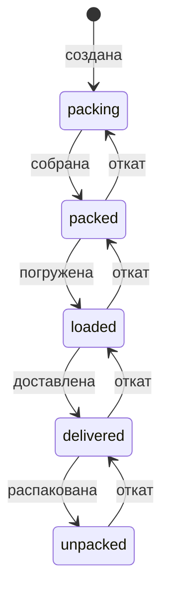
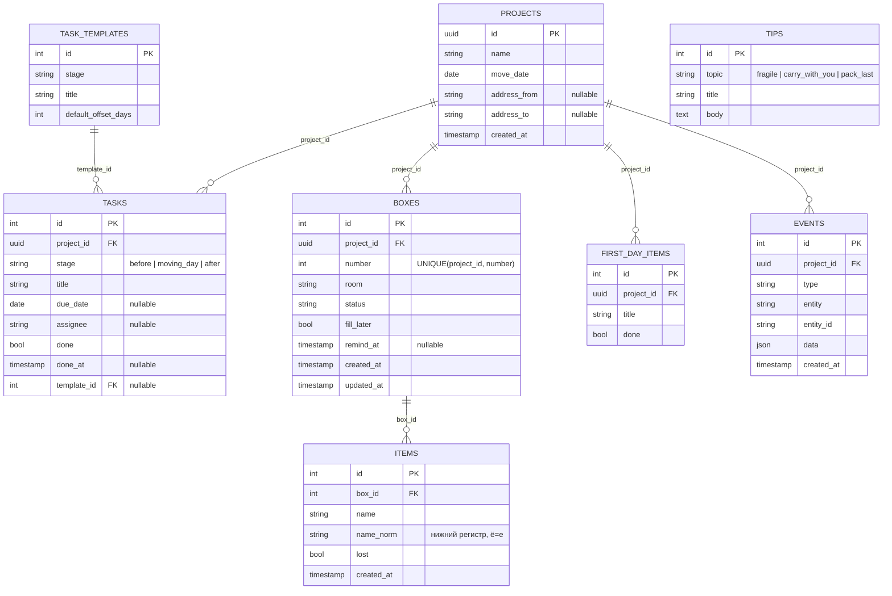

# Архитектурный документ: MoverMate

> Структура — по этапам проектирования: 1) требования, 2) сценарии, 3) данные, 4) API, 5) архитектура и решения.
> Источники: ТЗ «MoverMate — переезд без хаоса» (разобрано в `docs/CASE.md`), контракт — `docs/API.md`.
> **Статус документа:** проектное описание до реализации. Главное правило жюри: документ соответствует реальной системе. После реализации каждого блока сверить раздел с кодом и Swagger и убрать пометку «план», если она появится.

## 1. Требования

**Пользователь.** Человек или семья, готовящиеся к переезду. Ролей и учётных записей нет: проект доступен по неугадываемой UUID-ссылке; «ответственный» за задачу — просто имя.

| Группа | Требования (нумерация — как в таблице минимума `CASE.md`) |
|---|---|
| План (5.1) | проект с названием, датой, необязательными адресами; задачи трёх этапов; шаблоны, свои задачи, срок, ответственный, отметка выполнения |
| Коробки (5.2) | уникальный номер и комната; список вещей, быстрый ввод; отложенное заполнение с напоминанием; 5 статусов; удаление с подтверждением |
| Поиск и этикетки (5.3) | поиск вещи по названию (коробка, комната, статус); поиск коробки по номеру; этикетка с QR; печать/PDF; показ на телефоне; QR открывает карточку |
| Контроль (5.4) | чек-лист погрузки по комнатам; доставка; счётчики по статусам; прогресс распаковки по комнатам; чек-лист первого дня; «потеряна» + подсказки |
| Памятки (5.5) | хрупкое, что везти с собой, что паковать последним; хранятся локально |
| Надёжность | уникальные номера; повторный скан QR не создаёт дубль; статусы только по допустимым переходам; одинаковые запросы → одинаковые ответы; данные переживают обновление страницы |
| Приватность | персональные данные и адреса необязательны; нет скрытых передач третьим лицам; QR и этикетки генерируются локально |
| Производительность | сотни коробок и тысячи вещей; быстрый поиск; фильтры и пагинация |
| Наблюдаемость | журнал важных событий; проверка работоспособности |
| Запуск | без сложных внешних настроек и интеграций (`docker compose up`) |

**Вне объёма (осознанно):** авторизация и роли; push, почта и Telegram-уведомления; серверная генерация PDF; список всех проектов на сервере; обязательное использование внешних ML-сервисов. Дополнительные функции (раздел 6 ТЗ) делаются после минимума и по умолчанию без внешних вызовов.

## 2. Сценарии и процесс

Четыре сценария ТЗ: планирование, упаковка и учёт, маркировка и поиск, контроль переезда.

**Жизненный цикл коробки** (единственная нетривиальная машина состояний):



Правила (таблица `TRANSITIONS` в `backend/app/services/`):

- Допустим один шаг вперёд и один шаг назад (исправление ошибочной отметки). Пропуск шагов («собирается» → «распакована», «доставлена» → «распакована» через минуту после «собрана») → `409`.
- Нельзя перейти `packing → packed`, если в коробке нет вещей и она не помечена «заполнить позже».
- Массовая погрузка (`bulk-transitions`) атомарна: один недопустимый номер отклоняет всю операцию.
- Каждый переход пишется в журнал событий в той же транзакции.

**Главный сценарий:** проект → задачи по этапам → коробка + быстрый ввод → этикетка и QR → погрузка → доставка → распаковка → поиск и «потеряна». Подробный демо-сценарий — `CASE.md`, раздел 6.

**Напоминания.** Коробка с `fill_later = true` и без вещей попадает в список напоминаний сразу (если `remind_at` не задана) или после наступления `remind_at`. Напоминание вычисляется при запросе, а не рассылается: нет фоновых задач и внешних каналов.

## 3. Данные



Решения по данным:

- **Номер коробки** — отдельное целое поле, а не `id`. Уникальность гарантирует ограничение БД `UNIQUE(project_id, number)`. Номер выдаётся в транзакции как `max(number) + 1` под блокировкой проекта; при гонке запись повторяется. Удалённые номера не переиспользуются: напечатанная этикетка не должна указывать на чужую коробку.
- **`name_norm`** хранится и индексируется: поиск нечувствителен к регистру и к `ё/е` без функций в запросе и одинаково работает на SQLite и PostgreSQL.
- **Комната** — строка в коробке. Отдельная таблица не нужна: нет атрибутов комнаты, а прогресс по комнатам считается агрегатом `GROUP BY room`.
- **Журнал `events`** хранит тип, сущность и небольшой JSON (например `{"from":"packed","to":"loaded"}`), без персональных данных.
- **Каскадное удаление:** проект → всё содержимое; коробка → вещи.
- **Справочники** (`task_templates`, `tips`) и шаблон первого дня загружаются seed-ом и хранятся в той же БД: локально, без внешних источников.

Индексы: `boxes(project_id, number)` (уникальный; карточка, QR, поиск по номеру), `boxes(project_id, room, status)` (фильтры, прогресс), `items(box_id)` (содержимое), `items(name_norm)` и на PostgreSQL триграммный индекс `gin (name_norm gin_trgm_ops)` (поиск по вхождению в тысячах записей), `tasks(project_id, stage)`, `events(project_id, id desc)`.
Миграции: `backend/alembic/versions/`, применяются при старте; CI проверяет `upgrade → downgrade → upgrade` на PostgreSQL.

## 4. API

Полный контракт — `docs/API.md`; после реализации источник правды — Swagger `/api/docs` и OpenAPI `/api/openapi.json`.

| Группа | Основные пути |
|---|---|
| Служебные | `GET /api/health`, `GET /api/task-templates`, `GET /api/tips` |
| Проекты | `POST /api/projects`, `GET/PATCH/DELETE /api/projects/{pid}` |
| Задачи | `GET/POST /api/projects/{pid}/tasks`, `PATCH/DELETE …/tasks/{tid}`, `POST …/tasks/apply-templates` |
| Коробки | `GET/POST /api/projects/{pid}/boxes`, `GET/PATCH/DELETE …/boxes/{n}`, `POST …/boxes/{n}/transitions`, `POST …/boxes/bulk-transitions` |
| Вещи | `GET/POST …/boxes/{n}/items`, `POST …/boxes/{n}/items/bulk`, `PATCH/DELETE …/items/{id}`, `GET …/items/lost`, `GET …/items/{id}/hints` |
| Поиск и этикетки | `GET …/search?q=`, `GET …/boxes/{n}/label`, `GET …/labels?numbers=` |
| Контроль | `GET …/progress`, `GET …/reminders`, `…/first-day` (CRUD), `GET …/events` |
| Ассистент (после минимума) | `POST …/assistant/checklist`, `…/checklist/apply`, `…/room-plan`, `…/box-from-photo` (по явному согласию) |

Единый формат ошибки: `{"detail", "code", "request_id", "errors?"}`. Коды: `404` нет сущности, `409` недопустимый переход статуса, `422` неверные данные или нет `confirm=true` при удалении, `429` лимит запросов.

## 5. Архитектура и решения

```
Мобильное приложение ──HTTPS /api──► FastAPI ──► PostgreSQL
 (Expo, React Native)                router → service → repository
 QR, этикетки, PDF строятся на устройстве
```

Компоненты: `db` (PostgreSQL 16), `backend` (FastAPI, SQLAlchemy, Alembic), `mobile` (React Native + Expo, TypeScript; Android APK). Сервер (`db` + `backend`) поднимается `docker compose up`, демо-данные подгружает seed; URL сервера приложение берёт из настройки сборки.

| Решение | Почему |
|---|---|
| Доступ по UUID проекта, без авторизации | ТЗ не требует аккаунтов и просит минимум персональных данных; вход не добавляет ценности к сценариям. UUID v4 неугадываем; списка проектов на сервере нет. Ограничение: ссылка = доступ, её нельзя отозвать (см. ограничения) |
| Слои router / service / repository | логика не в контроллерах; сервисы тестируются без HTTP; машина статусов — чистая функция |
| Переходы статусов — таблица `TRANSITIONS` | новый статус или правило — одна строка плюс тест; нет разбросанных `if` |
| Откат статуса на один шаг назад | пользователь ошибается при отметках погрузки и доставки; правка важна, но пропуск шагов остаётся запрещён (требование ТЗ) |
| Смена статуса, запись события и проверки — в одной транзакции со `SELECT … FOR UPDATE` по коробке | два помощника отмечают одну коробку одновременно: журнал не расходится с состоянием, нет «двойного» перехода |
| `UNIQUE(project_id, number)` и выдача номера в транзакции | уникальность номеров — требование ТЗ; ограничение БД срабатывает, даже если сервисный код ошибётся |
| QR кодирует относительный путь `/projects/{pid}/boxes/{n}`, а `GET` карточки ничего не создаёт | повторный скан не создаёт дубль; этикетка работает при любом домене |
| QR строится на устройстве (`react-native-qrcode-svg`), PDF — `expo-print`, сканер — `expo-camera` | ТЗ: локальная генерация, без внешних сервисов и скрытых передач; серверный PDF не нужен |
| Поиск: нормализованное имя, индекс, детерминированная сортировка (точное → начало слова → вхождение → номер коробки → id) | одинаковые запросы всегда возвращают одинаковый порядок; быстрый поиск на тысячах записей |
| Пагинация `page/page_size` на всех длинных списках | ТЗ: сотни коробок и тысячи вещей |
| Удаление требует `confirm=true` | подтверждение из ТЗ закреплено и на сервере: случайный `DELETE` не проходит |
| Журнал событий в БД (`events`) плюс JSON-логи в stdout с `request_id` | журнал бизнес-событий виден пользователю и жюри; технические логи — для диагностики |
| `GET /api/health` с запросом к БД и индикатор в приложении | требование ТЗ; тот же эндпоинт — healthcheck в Docker и пайплайне |
| Напоминания вычисляются при запросе | нет планировщика и внешних каналов: проще запуск и меньше причин для отказа |
| Ассистент работает на локальных правилах; внешний вызов (фото) только с явным согласием и заголовком | ТЗ запрещает скрытую передачу данных; минимум не зависит от внешних сервисов |
| Состояние на клиенте: `pid` проектов в AsyncStorage | перезапуск приложения не теряет контекст, данные берутся из API |
| Приложение ходит в API напрямую по HTTPS | нативному клиенту CORS не нужен; HTTPS обязателен, иначе Android блокирует HTTP-трафик |
| React Native + Expo + React Native Paper (Material 3) | один язык с шаблоном; запуск на телефоне без Android Studio (Expo Go); готовая компонентная база и гайдлайны Material для мобильного жюри; APK собирается в облаке EAS |
| SQLite локально, PostgreSQL в Docker/CI; тесты на обеих | быстрый старт; различия СУБД (блокировки, триграммы, `LIKE`) ловятся в CI |

**Тестирование и CI.** Юнит-тесты: таблица переходов, парсинг быстрого ввода, нормализация имён, ранжирование поиска, подсказки для потерянных вещей. Интеграционные: сценарии из `docs/API.md` (параллельные `POST /boxes`, недопустимый переход, повторный скан, детерминированный поиск, `delete` без подтверждения, атомарность `bulk-transitions`). Пайплайн: линтер → тесты с отчётом о покрытии → сборка образов → деплой.

**Известные ограничения:** доступ по ссылке нельзя отозвать (при утечке ссылки данные открыты; смягчение — не хранить персональные данные, адреса необязательны); у проекта нет владельца и совместного редактирования с разграничением прав; напоминания видны только при открытии приложения; ограничение запросов — в памяти одного процесса; нет бэкапов базы и HTTPS (см. `DEPLOY.md`); распознавание по фото и план упаковки комнаты — после минимума и могут быть не реализованы.
